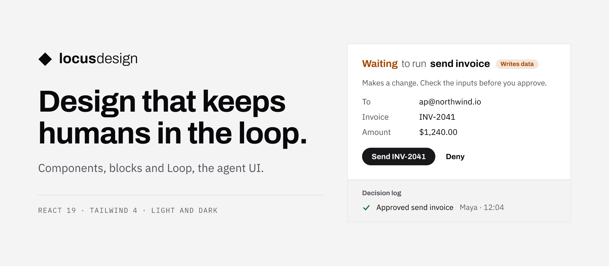

<picture>
  <source media="(prefers-color-scheme: dark)" srcset=".github/assets/hero-dark.png">
  
</picture>

<p align="center">
  <a href="https://www.npmjs.com/package/@locusgraph/components"></a>
  <a href="LICENSE"></a>
  <a href="https://design.locusgraph.com/r/registry.json"></a>
</p>

<p align="center">
  <a href="https://design.locusgraph.com"><b>Docs</b></a> ·
  <a href="https://www.npmjs.com/org/locusgraph">npm</a> ·
  <a href="https://design.locusgraph.com/DESIGN.md">DESIGN.md</a> ·
  <a href="https://design.locusgraph.com/generative-ui">Generative UI</a> ·
  <a href="apps/example-next">Examples</a>
</p>

# Locus Design

A design system for agent products. React components on Radix, product blocks, and Loop, the agent
UI where a person approves what the agent does. One square, ruled theme in light and dark.
React 19, Tailwind 4, Phosphor icons.

## Install

```bash
pnpm add @locusgraph/components @locusgraph/blocks @locusgraph/loop
```

```css
@import "tailwindcss";
@import "@locusgraph/components/theme.css";
@import "@locusgraph/blocks/sources.css";
@import "@locusgraph/loop/sources.css";
```

```tsx
import { Button } from "@locusgraph/components";
import { ApprovalGate, useApprovalGate } from "@locusgraph/loop";
```

Theme variables are all `--locus-*`, so they never clash with an app's own. An app that also uses
its own shadcn components adds `@import "@locusgraph/components/shadcn.css";` after the theme.

### Or copy the source with shadcn

Every component, block and Loop part is in the
[registry](https://design.locusgraph.com/r/registry.json):

```bash
pnpm dlx shadcn@latest add https://design.locusgraph.com/r/theme.json https://design.locusgraph.com/r/approval.json
```

## Packages

| Package | Version | What it is |
|---|---|---|
| [`@locusgraph/components`](packages/components) | [](https://www.npmjs.com/package/@locusgraph/components) | React components on Radix, Rule Grid, the App and Docs shells and the theme. Start here |
| [`@locusgraph/blocks`](packages/blocks) | [](https://www.npmjs.com/package/@locusgraph/blocks) | Product sections: `Usage`, `Quota`, `Wallet`, `TopUp`, `Plans` and `Keys`, with skeletons |
| [`@locusgraph/loop`](packages/loop) | [](https://www.npmjs.com/package/@locusgraph/loop) | Agent UI with the human in the loop: chat, tools, approvals, decision log, memory and cost |
| [`@locusgraph/json-render`](packages/json-render) | [](https://www.npmjs.com/package/@locusgraph/json-render) | A [json-render](https://json-render.dev) catalog and registry, so a model can lay out screens as JSON |
| [`@locusgraph/tokens`](packages/tokens) | [](https://www.npmjs.com/package/@locusgraph/tokens) | The theme as CSS (palette, type, hairlines, motion) and as TypeScript values |
| [`@locusgraph/brand`](packages/brand) | [](https://www.npmjs.com/package/@locusgraph/brand) | Marks, wordmarks, app icon, social card, and the Google and GitHub marks |
| [`@locusgraph/email`](packages/email) | [](https://www.npmjs.com/package/@locusgraph/email) | Transactional email templates with inline styles from tokens |
| [`@locusgraph/utils`](packages/utils) | [](https://www.npmjs.com/package/@locusgraph/utils) | Money, counts, dates, quota and balance helpers. No dependencies |
| [`@locusgraph/config`](packages/config) | [](https://www.npmjs.com/package/@locusgraph/config) | Biome, TypeScript, Vitest and PostCSS settings |

Examples: [Next.js App Router](apps/example-next) and [React with Vite](apps/example-react).

## For AI agents

[DESIGN.md](https://design.locusgraph.com/DESIGN.md) lists every page with a Markdown version: add
`.md` to any docs path.

## Develop

```bash
pnpm install
pnpm dev             # docs on http://localhost:5180
pnpm check           # lint, typecheck, test, registry build
pnpm registry:test   # install every registry item into a fresh shadcn app and build it
```

Fix a component here, not in a copy inside an app, and release it, so every app gets the fix.

## License

[MIT](LICENSE)
